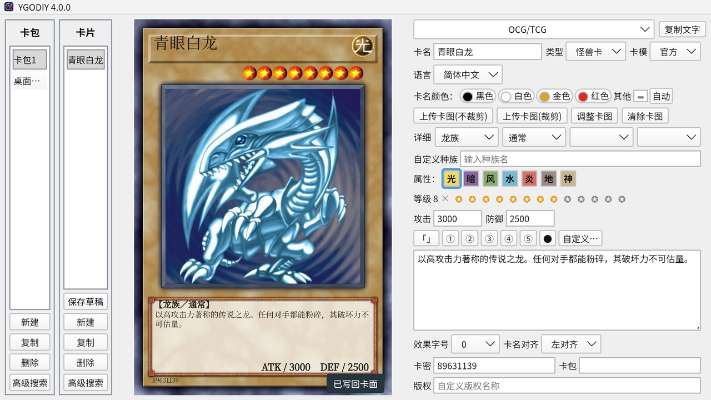
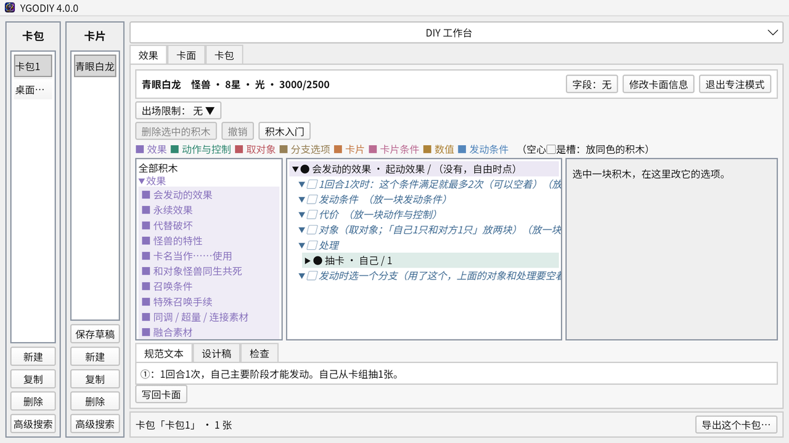

# YGODIY 安卓横屏版

[Android 1.0.0 安装包](https://github.com/YYY-ZSJ/YGODIY/releases/tag/android-v1.0.0)。支持 Android 10 及以上，使用系统 Android WebView。卡面、草稿、积木文字和教程都可在飞行模式下使用。APK 无需网络权限和全盘文件权限。





## 在手机上使用

1. 横屏打开制卡器。左侧「卡包」「卡片」各有新建、复制、删除和高级搜索，长按条目后可拖动排序。卡名、卡图和参数在编辑时保存，左侧「保存草稿」可手动再存一次。
2. 用顶部下拉框选 OCG/TCG、超速决斗、场地中心卡、卡背、旧版卡或漫画卡。中间预览卡面，右边自上而下编辑。小屏可双指放大查看细节。
3. 选择「DIY 工作台」→「效果」。点左栏的一种效果开始，点中栏的槽，再点左栏中要放入的积木。点中栏已放好的积木，右栏会显示可调整的参数。「规范文本」下方的「写回卡面」会替换当前卡的文字。
4. 「积木入门」位于「DIY 工作台」和「支持作者」之间。内含入门练习、21 节决斗规则、图解、240 块积木的词条和抽卡练习桌。
5. 「导出图片」生成 PNG，可勾选四周 3 毫米出血与裁切标记。要继续编辑或换设备，选「导出数据」或工作台「卡包」里的导出按钮，保存单卡或整包的 `.ydiy`。导入会新建一包。工程交换卡名、卡面文字、攻守、主要卡种参数、卡图、中文积木及自定义编号。手机版专有的裁图位置和版式设置也会随工程保存。

手机版专注于制卡和中文效果，无伊格尼斯、Lua 脚本、游戏扩展包安装或模拟对局功能。手机使用系统字体，导出结果可能与 Windows 的字形和断行有差别。系统文件选择器用于选择卡图和保存工程。

## 从源码构建

需要 Python 3.12、Pillow、cryptography、JDK 17、Android SDK Platform 35 和 Build Tools 35.0.0。构建器直接调用官方 aapt2、javac、D8、zipalign 和 apksigner。整个目录可从仓库根目录构建。

先按仓库根目录说明准备桌面构建资源，解压后的目录应包含 `mold`、`Rush_Duel` 等子目录。然后运行：

```sh
python -m pip install Pillow cryptography
python android/tools/prepare.py --resources /path/to/resources
python android/tests/test_reader.py
```

准备步骤从现有卡框生成移动端图片，从桌面积木目录、中文读法和手册生成离线资料。首次准备会下载固定版本的 Pyodide 并校验 SHA-512。要离线重建，可通过 `--cache` 指定已经存有 `pyodide-0.26.4.tgz` 的目录。安卓可执行包只包含所需素材和文字生成器。

创建或选用自己的 Android 签名库（首次可用 JDK 的 `keytool -genkeypair`）。设置 `ANDROID_HOME`、`JAVA_HOME`、`YGODIY_STORE_PASS`，若私钥口令不同，另设置 `YGODIY_KEY_PASS`。签名凭据由构建机管理。请备份自己的发行签名库，后续覆盖更新需使用同一证书。

```sh
python android/tools/build.py --keystore /private/path/release.p12 --alias ygodiy-android
```

输出为 `android/build/YGODIY-Android-1.0.0.apk`。可用 `--sdk` 和 `--jdk` 指定工具目录。开发时可加 `--debug` 构建独立命名的调试文件，发行包关闭 WebView 远程调试。

卡框、卡图的权利归其原权利人；默认青眼白龙图取自项目使用的卡图资料。运行库许可见 [notices](notices/)，桌面资源说明见[第三方资料声明](../THIRD_PARTY.md)。离线标准库使用 APK 内的 `runtime/stdlib.data`，运行时由应用资源管理器读取。
