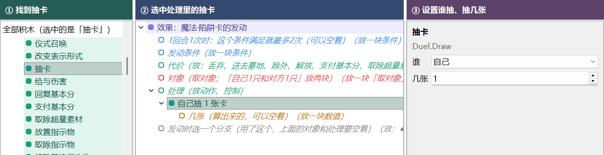
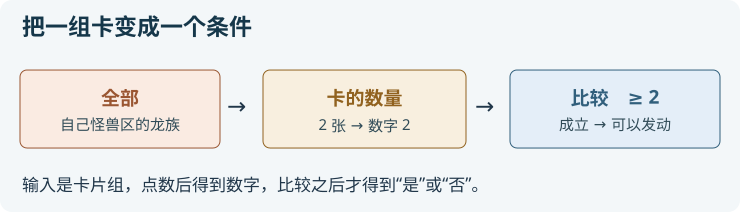

## 新手路线 · 第一次打开从哪里开始

如果还分不清卡组和墓地，先点上面的「决斗规则」，看前四节的图，读到主要阶段就可以动手。想看清图里的小字，点下方「查看配图原图」。读完回到「入门练习」，在章节里选「第一张卡 · 让自己抽一张」。

**先试一次没有代价的操作。** 打开「练习桌」，选抽卡题，在中栏放「会发动的效果」，再点它的处理槽并双击「抽卡」。如果不知道下一步选什么，点「看搭法」对照树，或在图鉴搜索「抽卡」。可以在练习桌修改和重试。要把成功的设计做成自己的卡，再点「返回 DIY 工作台」，按教程在练习包里搭建并保存草稿。

**三条路。** 想弄懂“为什么不能发动”，找规则里的「连锁」「回合」或练习里的「从现象排错」。想弄懂一块怎么填，去「积木图鉴」，输入它在界面上的名字，点下面的结果。已经在工作台选中某块时按 F1 可直接查看该块。

## 学会用积木表达一个步骤

把「自己从卡组抽2张」拆开读。**动作**是抽卡，**参数**是“自己”和“2”，**结果**是两张牌从卡组移到手卡。中栏实心行是已有的步骤，空心行是等你填的输入。双击左栏条目会添加步骤。点中栏已放好的块才会在右栏看到参数。

**第一次练习只做一个改动。** 把张数从1改到2，看「规范文本」对应数字是否变化。如果没变，重新点中栏的抽卡块，看看右边的「几张」是不是2，以及下面有没有另一块提供动态张数。「撤销」可以退回刚才的一步。

**顺序与嵌套。** 在同一「处理」槽里放两个动作，通常由上往下执行。把动作放入「如果 → 那么」里面，它只在条件成立时执行。判断的方法是看缩进的父行。拖到相邻位置与拖到某块的槽里含义不同。

**读图练习。** 想改成对方抽2张，哪个地方要动？保留中栏的抽卡块，在右边把「谁」改为对方即可。改变卡的名字不会改变谁抽卡。

## 卡、卡片组、数字和条件怎么区分

拿「自己场上有至少2只龙族，就回复500」来试。先用「全部」选自己怪兽区，再在它的「什么样的卡」里放「种族＝龙族」。这一步交出的是**一组卡**。将这组卡接进「卡的数量」，得到**数字**。把数字交给「比较」，右边放数字2并选≥，得到**是或否**。

如果必须满足条件才能发动，把整个比较放进「发动条件」。若卡可以先发动，处理时符合才回复，把比较放进处理中的「如果」，在「那么」放回复500。两个版本在空场时的发动按钮表现不同。涉及其他必要处理或对象时，还要满足各自的发动要求。

**出现“放不进去”时看接口。** 卡片槽接能提供卡或卡组的块，数字槽接能提供数值的块，条件槽接能给真假答案的块。点空心槽时左栏会只列出合适积木。图鉴条目也能点开该槽允许连接的积木。

**自测。** 场上摆龙族1只与战士族1只，为什么不回复？先筛选后只有1只符合，1≥2为假。再增加一只龙族，应当成立。

## 记名字、选分支、重复动作和使用函数

**变量**是给一件东西临时取名，好让下一步仍能找到它。目标在发动时取1只记作T，处理时「对象」也要读T。另一个常用名字A可以用来记处理时选出的卡组。把名字串错，即便槽的颜色对上也取不回原来那组。

**分支**是先回答一个问题，再决定走哪条路。练习把「对方场上有怪兽」作为「如果」，那么抽1张，否则回复500。分别在空场和有怪兽时试，两条路都要验证。

**循环**是对一组东西重复步骤。给每只己方怪兽各加100时，「对每一张」的输入是全体己方怪兽，内部读取「当前这张」。只放一只时可能看不出取错，要摆两只数值不同的怪兽作对照。

**函数**是一组可被叫来做事的步骤。游戏把发动合法性问题交给目标或代价函数，把实际结果交给处理函数。Lua 中 chk==0 表示“现在只是问能不能做”。若在这时扣分、移卡或抽牌，游戏每问一次就会错误地改变场面。tp通常表示该效果的相应玩家，1-tp是另一方。变量、卡片组和回调不熟时先读一张抽卡魔法，再去图鉴搜具体接口。

## 从现象排错 · 定位到一个槽

**左栏有块却加不进去。** 看中栏选的是空心槽还是已放好的积木。点想要的空心槽，读左栏筛选出的候选。只容一块的槽已有内容时，选中里面那块再删除或撤销。普通效果和「整卡脚本积木」是不同的顶层结构。可在练习桌先搭普通效果，回手写项目时再看转换。

**能生成文字却不能发动。** 依次问自己五件事：卡种和效果类型配对吗？卡在允许的区域吗？是谁的回合和阶段？代价现在能付吗？发动时存在合法对象吗？只改变其中一项重试。例如原来对方空场就放一只可被选的怪兽。如果新局面出现发动提示，已经缩小了原因范围。

**发动了却什么都没发生。** 先看是否被无效，再看目标是否已离场或不受效果影响。比较连锁发生前、代价付完、处理完成后三个时点。若只能读到空值，查「对象」T与「记下的卡」A是否分别对应先前写入的名字。若实际数量不对，查有没有计算槽覆盖了右栏的固定数字。

**卡片文字和游戏结果不一样。** 先看规范文本，再核对生成的 Lua 和实际卡号。整卡脚本的玩家可读文字要随设计一并修改。用「写回卡面」同步卡面，重新导出带脚本的 .ypk，确保游戏载入了本次文件。同名不同号的旧测试卡也可能是你在游戏中选到的那一张。

**沙盒显示未验证。** 先看「检查」里哪一步报错。仅通过加载能证明脚本登记等步骤执行过。需要触发战斗、卡被除外或复杂连锁时，搭一个最小局面，准备相关怪兽或回应卡，写下发动前后的预期。把“缺对象”“做不到”“对方无效”各试一次。练习桌的核对也只是与本题的目标结构或生成脚本对照。

## 三道自测 · 答错后回哪一步

**第一题。** 想让怪兽回复自己500基本分，把500拖到顶层却放不进去，应该先放哪块？先在「处理」放「回复基本分」，谁选自己，再点它下面的「多少」放「数字」500。顶层留给整条效果。

**第二题。** 想在发动时锁定一只怪兽，为什么用「处理 → 选几张」时，对方回应前没看到目标？那是在处理时才选择。回到顶层的「对象」槽，用「取对象」记作T。处理时接「对象」T。用另一张牌在连锁中移走T，再验证结果。

**第三题。** 想让攻击力2000的怪兽一回合限用一次、给自身加500直到回合结束，该看哪些数字？在根效果右栏选「这张卡1回合1次」，处理用「给卡片登记效果」、当前攻击力上升、数字500、期限到回合结束。首次结算应到2500，本回合再试应不能重复发动，到期回2000。若目标是让每张同名副本共享次数，则在顶层换成同卡名限制。

知道答案后仍建议实际点一次，把每道题最容易错的那个槽换错再改回。这样下次遇到相同现象，你能用对照局面找到问题。
