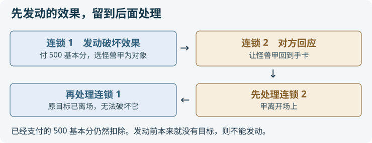

## 把一句效果拆成四个时间点

先问**此刻允许发动吗**，再问**现在就要付什么、选谁**，然后让双方决定是否回应，最后才实际处理。积木树中的「发动条件」「代价」「对象」「处理」正好帮助你这么安排。规则要求存在合法对象或能执行必要处理时，发动前也要检查这些条件。

**跟着一笔基本分。** 自己8000分，对方有怪兽甲。你发动「支付500基本分，以对方1只怪兽为对象发动，那只怪兽破坏」，先到7500并选甲。对方回应把甲弹回手卡。轮到你处理时，原对象已离开，不会改选乙，也不会退500。若发动前对方就没有可选怪兽，则不能宣布这个发动，也不扣500。

「发动时选对象」用「取对象」，「处理时选卡」常用「选几张」或「让玩家选卡」。两者都可能出现点卡窗口，**窗口出现在对方能否回应的哪一侧**才是关键。对方免疫取对象不等同免疫所有影响。[官方效果文字与发动流程](https://www.yugioh-card.com/en/play/psct/psct-3/)

## 连锁、咒文速度和行动机会

一方发动卡或效果构成连锁1，另一方获得回应机会。再发动就是连锁2。双方依规则都放弃添加后，从编号最大的那项向前处理。一个链节处理过程中通常不能再插入新的发动。处理期间满足的诱发条件，会留到合法的下一个窗口检查。

常见咒文速度1包括通常魔法、怪兽起动效果等。快速效果如速攻魔法、通常陷阱、怪兽的诱发即时效果通常为速度2。反击陷阱为速度3，回应速度3需要速度3且条件吻合。普通速度1效果一般不能被主动拿来随意接在别人的快速效果后。多个同一时点满足条件的诱发效果有它们自己的组链规则。

**一条两环练习。** 连锁1令自己抽1张。对方连锁2用合法的无效手段。结算先处理无效，再轮到原效果。如果无效成立就没有抽卡。把连锁2换为只破坏一张普通魔法的效果，再观察。把牌移走与无效其发动或效果是不同操作。

**谁先行动。** 空闲局面中回合玩家能先做合法操作。操作发生后检查诱发及快速效果时机，再依规则轮流交还机会。把种类写为快速效果也要满足地点、窗口、对象和代价。[官方快速效果时机图](https://www.yugioh-card.com/en/play/fast-effect-timing/)

## 同时诱发、可选时点与连锁处理中发生的事

诱发效果是某件事发生后才检查的效果，如「这张卡被送去墓地的场合」。有的必须发动，有的写「可以」由玩家决定。多个公开位置的诱发在同一时点满足条件时，通常按回合玩家必发、非回合玩家必发、回合玩家选发、非回合玩家选发的顺序组织，各自在同组内按规则安排。手卡等非公开位置的诱发、特殊限制和不同赛制的处理有额外细则，遇到具体组合查对应卡问答。

「……时，可以……」一类选发效果要关注发动窗口打开前**最后发生的事**。例如先破坏怪兽，那之后再抽卡。若诱发要求「被破坏时可以发动」，最后发生的是抽卡，可能错过时点。「……场合可以……」与必发效果的判断另有条件，不能把所有含「可以」的卡都判成错过时点。诱发条件满足后又在允许发动前离开发动位置，也要依现行规则重新检查。

**在积木里做对照。** 把同一动作组分别写成「那之后」和同时处理的连接方式。用两张测试卡，一张监听破坏、一张监听抽卡，在对局里观察何时询问。别由中文预览的先后字序推断两项一定错开时点。[官方规则及修订入口](https://www.yugioh-card.com/japan/howto/)

## 破坏、丢弃、解放、送墓和除外

同一个最终位置可能由不同动作到达。手卡因「丢弃」进墓、怪兽因战斗破坏进墓、仪式素材因解放进墓，都会有“被送去墓地”的机会，但只有相应的一项符合丢弃、战斗破坏或解放条件。规则把装备送墓、作为素材送墓、支付代价等也各有原因，动作产生的事件不可随意互换。

替代效果可能让卡原本要去墓地时改为除外。卡文要求「把这张卡送去墓地才能发动」时，代价必须按指定方式实际支付。场上有替换去向时，常会出现无法发动。若只要求「丢弃」且没有指定去向，则另按卡文判断。回手、回卡组、表侧除外、里侧除外也应使用各自的动作。

**在编辑器重演。** 做两份练习，一份选「破坏」，另一份选「送去墓地」。拿有「不会被效果破坏」的怪兽作目标。第一份受破坏抗性影响，第二份要查「能否送墓」与有无其他保护。测试完再给目标另加「不会成为效果对象」，观察是发动时选不到，还是处理时做不成。

**读位置。** 问现在放在哪用「现在所在的区域」，问送墓前在何处用「之前在哪」，问是哪张卡造成的用「原因卡／原因效果」。从场上回到里侧主卡组、里侧额外卡组或成为超量素材时，「离场时」发动的效果要按现行规则判断。[官方有关离场的规则更新](https://www.yugioh-card.com/eu/play/2021-rules-update/)

## 次数、重置、无效、抗性和代替

「这张卡1回合1次」通常跟随场上的这张实体，「这个卡名的效果1回合只能使用1次」通常令不同副本共享限制。「发动次数」与「使用次数」的措辞在发动被无效时可能导致不同结果。先按你要复现的原卡文字选择次数，再用第二份同名卡验证。暂时无效后恢复、离场再回、进入下回合也应分别测试。

**先定位阻止发生在哪里。** 不能被取对象会限制发动时选择。不受某类效果影响在效果适用或处理时体现。不会被效果破坏只抵挡相应破坏。破坏代替则改由另外的合法处理承担。让某次发动无效、让某次效果无效以及持续无效一只怪兽，作用的对象和期限均不同。

普通魔法的发动后，单纯破坏那张魔法通常不会自动无效已发动的处理。永续魔法、场地、装备、永续陷阱等对留场的要求又不同。不要把一次测试的结果推广到每种牌。

**重置练习。** 给怪兽登记加500攻击力，期限选回合结束，记录加成前、加成后、到期后的三个数。下一局在结束前先把怪兽移走再返回，检查新对象有没有不应保留的数值。[官方卡片个别问答](https://www.db.yugioh-card.com/yugiohdb/faq_search.action?request_locale=ja)

## 伤害步骤的五段与发动限制

依次分清**伤害步骤开始、伤害计算前、伤害计算时、伤害计算后、伤害步骤结束**。在攻击宣言时做的事还处于战斗步骤。攻击里侧守备怪兽时，通常在伤害计算前翻开，在伤害计算时比较攻守，战斗破坏确定后再于相关时点送墓。反转效果的发动要依它所属的窗口处理。

伤害步骤里只有规则或卡文允许的类型可发动。直接改变攻守的快速效果通常只能在指定的前半窗口使用，反击陷阱、无效发动的效果、明写某一时点的效果等按各自规则判断。能够响应在一般战斗阶段的事件，并不保证能响应伤害计算时的同类事件。

**给积木一个具体问题。** 想在攻击宣言时无效那次攻击，时机就选「攻击宣言」。若设计写「伤害计算已完成」，要搭配正确窗口，再用同名条件作进一步判断。用攻击力2000对1500的攻击表示怪兽，两端分别记下500何时实际扣除，便能看出选错时机。

**看不见发动提示时。** 先在正确窗口核对卡类型、咒文速度、必要资源，再检查编辑器中的「伤害步骤」选项。不要为了让提示出现而无条件开放整个伤害步骤。[官方伤害步骤逐段说明](https://www.yugioh-card.com/eu/play/damage-step-rules/)

## 永续与发动、当前值与原本值、谁控制谁持有

表侧怪兽给自己持续加500，通常在满足适用条件时立即体现。它主动发动一次提升到结束阶段，是另一次可回应的处理。需要记录持续时间。来源离场、目标里侧、效果到期或被无效都可能改变数值。多个数值设定与加成一起适用时，先辨清「变成」「上升」「原本的」和效果类别，特殊叠加顺序查官方问答。

**三个读数。** 一只印刷攻击力1500的怪兽因普通加成来到2000。「攻击力」读眼前的2000，「卡上写的攻击力」读1500。若某效果明确改变「原本攻击力」，再用「原本攻击力」来读。问“离场时有多少”则在离场事件中读「离场前的攻击力」。

**两种玩家。** 对手原本持有的怪兽被你夺取后由你控制，它的原持有者仍是对手。若从你场上被破坏，通常进原持有者的墓地。「由谁召唤」「之前谁控制」「原因玩家」也各问不同的问题。分别摆一只自己原有的和一只夺来的，用「卡片原本属于哪位玩家」测试。

**登记关系。** 一次发动选的对象通常只属于当前链节。要让永续陷阱之后仍记得某只怪兽，可以登记持续对象关系，再使用「这张卡的对象怪兽」读回。

## 怎样查裁定，以及 Rush Duel 的区别

先写清卡名或卡号、双方场面、在哪一个阶段、谁以谁为对象、连锁几、哪项已经处理。记录**发动之前是否有选项、发动时付了什么、结算后哪些区域或数字变了**。用官方数据库按卡号查原文和该卡的问答，再看官方规则更新。自制卡没有现成个别裁定时，找具有同一种动作和措辞的实卡，在同一组局面比较。页面提供的是常规规则，特殊卡文、赛制禁限及个别裁定要按对应环境核对。[游戏王官方卡片数据库](https://www.db.yugioh-card.com/yugiohdb/) · [OCG 规则更新](https://www.yugioh-card.com/japan/revision/)

**工作台所用规则。** 本程序的 DIY 工作台用 OCG/TCG 卡片资料和 MDPro3 效果脚本。速攻魔法是 OCG 的一类魔法卡，超速决斗（Rush Duel，界面写作「超速决斗(Rush Duel)」）则是另一套玩法。切换卡面模式会改变制图能力，不能据此把 OCG 脚本自动解释为 Rush Duel 规则。

Rush Duel 有专用卡及场地。通常每方3个主要怪兽格与3个魔陷格，起手4张，抽卡阶段按规则将手牌补到5张，已有5张以上通常仍抽1张。通常召唤次数与 OCG 不同。这里的 OCG 连锁、灵摆区和先攻练习按本手册前面的 OCG 章节使用。想专门学 Rush Duel，应从它的官方玩法页开始。[Rush Duel 官方玩法](https://www.konami.com/yugioh/rushduel/howto/)
