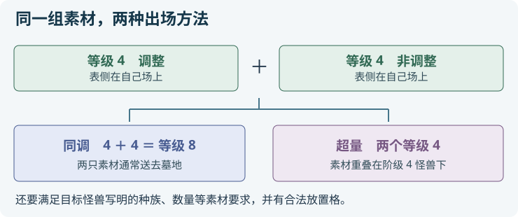

## 通常召唤、上级召唤、盖放与反转

通常情况下，自己每回合有一次通常召唤或通常盖放的机会，两者共享。等级4以下的普通怪兽通常可以直接召唤，等级5或6通常要解放1只，等级7以上通常要解放2只。上级召唤也是通常召唤。通常从手卡表侧召唤要用攻击表示，通常盖放用里侧守备表示。卡片文字有特别规定时按文字。

反转召唤是自己主动把里侧守备的怪兽翻成表侧攻击。用过通常召唤次数后仍可能反转召唤。怪兽刚被召唤或盖放的回合、已经宣言攻击的回合等，主动改变表示形式有规则限制。被对方攻击而翻开和主动反转召唤会触发不同事件。

**摆场练习。** 手卡放一只等级4和一只等级6怪兽，己方空场。通常召唤等级4后，本回合的通常机会通常已用掉，即使它能作为解放，也不能立刻用第二次普通上级召唤。稳定起见可先在另一局准备好一只场上怪兽和未使用的机会。

**搭积木时。** 在卡片顶层使用「不用解放 / 改变解放数的召唤」修改手续。卡文说由效果进行一次召唤时，用「进行1只怪兽的召唤」。怪兽离场作解放时，单写「破坏」不能表达这个原因。

## 特殊召唤、正规出场与苏生限制

特殊召唤没有一般性的每回合一次上限，但每次都必须有允许这么做的效果或合法的出场手续，并有合法放置区域。效果特殊召唤可发生在连锁处理过程中，例如「死者苏生」处理时把墓地怪兽放上场。按手续自行从手卡特殊召唤，或在主要阶段进行常规同调、超量、连接召唤等，通常无需为这项手续发动一个效果。

有的怪兽属于特殊召唤怪兽，需要先按正规的方式成功出场，才可能在以后被从墓地等地复活。卡文如果限定「只能用某方法特殊召唤」还须满足这项额外限制。一只融合怪兽直接从额外卡组被送去墓地，即便墓地里看得到它，通常也不能直接用苏生效果拉出来。

**用两个局面测试。** 第一局正规融合成功后让怪兽送墓，第二局从额外卡组直接送同种怪兽去墓地。拿同一张苏生卡尝试，差异在出场履历。规则允许的格子和卡片自身限制仍需逐项检查。

**积木选择。**「特殊召唤手续」用于设计自身出场方法，「召唤条件」规定允许范围，「特殊召唤」执行效果所做的动作。把三件事分清后，卡在手卡无法出场时就知道先看哪一层。[OCG 官方特殊召唤怪兽问答](https://www.db.yugioh-card.com/yugiohdb/faq_search.action?fid=163&ope=5&request_locale=ja)

## 仪式与融合召唤

仪式怪兽通常放在主卡组。多数仪式魔法指定从手卡仪式召唤，并要求解放手卡或场上怪兽，合计等级等于或以上。也有要求恰好相等、从其他位置召唤或另作替代的卡。按实际仪式效果读来源和等级要求，别只数素材张数。

融合怪兽放在额外卡组。通常通过「融合」一类效果，在其准许的范围内用融合怪兽上写明的素材进行召唤。可用位置、是否除外素材、是否允许对方场上或墓地作素材都看执行融合的那张卡。接触融合依怪兽写明的手续进行。把两张符合的素材摆在场上，本身不会自动发动一般的融合魔法。

**一次算清。** 等级6仪式怪兽用两只等级3合计为6，符合恰好6和至少6。等级4加3合计为7，只满足至少6这一项，仍要满足实际仪式卡的其他要求。融合素材若写「特定卡名＋一只龙族」，准备两张独立实体，不能让同一只怪兽同时占两个位置。

**在编辑器。**「融合素材」写到融合怪兽顶层。执行融合的魔法用「融合召唤」。仪式魔法的处理用「仪式召唤」，在右边核对仪式怪兽来源和等级运算。

## 同调与超量召唤

同调召唤通常需要自己场上表侧的调整与调整以外的怪兽，素材等级合计恰好等于同调怪兽的等级。素材送墓，怪兽从额外卡组特殊召唤。卡片可能指定素材种族、数量或其他条件。超量召唤通常需要自己场上符合指定相同等级的怪兽，把它们重叠在超量怪兽下方。超量怪兽用阶级，自身通常没有等级。

**看同一场面。** 表侧等级4调整和等级4非调整各一只，符合一般素材条件时可以做等级8同调，也可能做需要两只等级4的阶级4超量。选择同调后两只素材通常进墓。选择超量后两只素材一开始均在超量怪兽下面。取除一个后还剩一个。

超量素材不视为场上的卡。场上的怪兽变成超量素材时，一般不触发「从场上离开」的效果。素材后来被取除送墓，可以检查「被送去墓地」，不能仅凭它曾在怪兽区就算作这次从场上送墓。

**做法。**「同调 / 超量 / 连接素材」负责出场材料，「取除超量素材」负责之后发动效果的代价。问当前剩几个选「持有的超量素材数量」，问用过几只出场选「召唤用的素材数量」。[官方额外卡组及离场规则说明](https://www.yugioh-card.com/eu/play/2021-rules-update/)

## 灵摆召唤、刻度和表侧额外卡组

灵摆怪兽有怪兽效果和灵摆效果两个文字区域。在怪兽区作怪兽，在左右灵摆区作为魔法卡时使用对应的灵摆效果。通常在自己主要阶段每回合可以进行一次灵摆召唤，一次可选多只。合法等级必须严格位于两侧刻度之间。例如刻度2和7允许3、4、5、6级，两个端点不包括。

从手卡灵摆召唤一般使用空的主要怪兽区。从额外卡组表侧灵摆召唤，则要用可用的额外怪兽区或连接箭头指向的己方主要怪兽区。灵摆怪兽卡从场上本要送墓时通常表侧放到额外卡组。从手卡被丢弃、从超量素材被取除等情形不能据此一律判作从场上送墓。

**自己试算。** 刻度1和5，手卡有等级1、4、5三只怪兽。满足刻度的只有等级4。再把它放在表侧额外卡组，封住额外怪兽区且没有箭头指向己方空格，就算主要区有空位也不能从那里灵摆出场。

**怎么拼。** 在效果块的「灵摆卡：写在哪一栏」选对文字栏。需要检查格子时用「从额外卡组召唤可用的区域数」，把实际要出的怪兽接进去。[官方大师规则说明](https://www.yugioh-card.com/japan/howto/)

## 连接召唤、箭头和额外怪兽区

连接怪兽具有连接值与方向箭头，没有等级也没有守备力，不能成为守备表示或被里侧守备盖放。常规连接召唤使用自己场上符合要求的表侧怪兽。每只素材通常可算1，连接怪兽作素材时可算1或它本身的连接值。合计要等于目标的连接值，同时还要满足卡面写的素材**实体数与种类**。

**算一算。** 一只连接2效果怪兽加一只普通的效果怪兽，在素材文字要求「效果怪兽2只以上」时可用2＋1做连接3。若卡文明确要求「怪兽3只」，只有这两个实体就不够。一只连接3不能随意算成连接2。

从里侧额外卡组出场的融合、同调、超量怪兽依现行大师规则可使用普通的合法主要怪兽区。从额外卡组出场的连接怪兽和表侧灵摆怪兽仍受额外怪兽区或箭头限制。箭头指着另一只叫连接，双方箭头相互指向才叫相互连接。通常只使用一个额外怪兽区，额外连接等特殊场面另按规则。

**在积木里。**「所连接区的怪兽」取箭头上的怪兽，「互相连接的怪兽」要求双方互指，「连接值」读卡上的数字。「同一纵列」只看格子对齐，和是否有箭头无关。[官方额外卡组区域更新](https://www.yugioh-card.com/eu/play/2021-rules-update/)

## 衍生物、指示物、陷阱怪兽与其他特性

衍生物是效果在场上生成的怪兽，离场即消失。能否作解放、同调或连接素材要看使用条件和衍生物限制，不能成为超量素材。指示物是在合适的卡上按编号累积的标记，不是占一格的卡。若卡离场或变成里侧，放置的指示物通常会失去。

陷阱怪兽由陷阱效果把自己当怪兽特殊召唤，有的仍视为陷阱。怪兽区是否有格、脚本赋予的等级攻守和卡片数据都要核对。同盟怪兽可以按卡文成为装备。二重怪兽在规定状态下当作通常怪兽，再度通常召唤后取得效果。灵魂怪兽常有出场和回手限制，以该卡文字为准。反转是变为表侧的事件，反转效果与反转召唤并非一回事。

**三个「计数」。** 卡上可见的魔力标记用「放置指示物」。效果内部记住“本回合用过”用「做标记」。在卡上显示回合数字用「设置这张卡的回合计数」。用不同方法读写，数字便不会对应。

**自测。** 场上有一只衍生物和怪兽上的两个指示物，能否把三者当三张超量素材？不能。指示物不是卡，衍生物也不能作超量素材。
