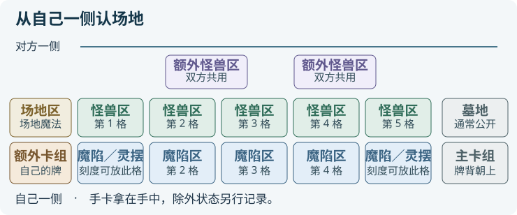
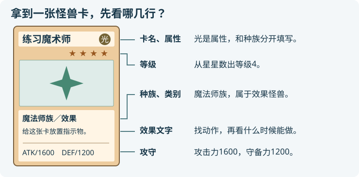
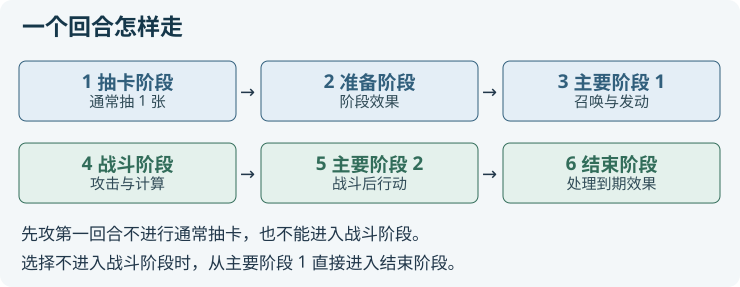
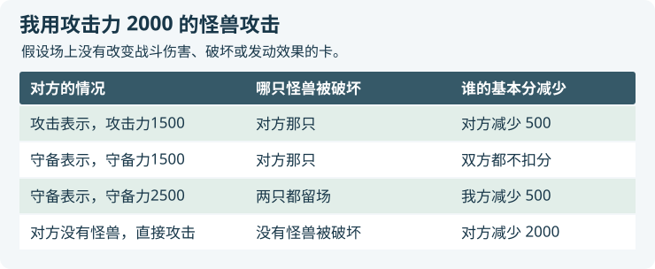

## 一局如何开始、结束和组卡

每位玩家准备主卡组40～60张。额外卡组最多15张，放融合、同调、超量、连接等从额外出场的怪兽。备牌组（副卡组）最多15张，用于多局比赛的局间调整。主、额外、备牌合计，同名卡通常最多3张。禁限卡表可能进一步降为2、1或0张，按正在玩的地区、日期和房规确认。

通常双方各以8000基本分（LP）和5张手卡开始。先攻第一回合没有通常抽卡，也不能进入战斗阶段。基本分归零会输，必须抽卡却不能抽足时也会输。有的卡有写明的特殊胜利条件。卡组刚变成0张时，只要此刻不用抽卡，通常还会继续决斗。个人对战中的一局叫决斗，多局决定胜负称为一场比赛。

**摆一摆。** 两人各把5张牌放到手边，留一叠作卡组。先攻者主要阶段发动一张「自己抽1张」的通常魔法时，照样能按效果抽牌。先攻首回合省略的是每回合那次通常抽卡。

**自测。** 卡组最后1张被效果送墓，自己还剩100基本分，哪时会因卡组耗尽落败？对照答案是下次必须抽卡却抽不到的时候。自制练习卡的卡号和正规赛制的参赛资格是两项不同资料。[官方 OCG 规则手册](https://www.yugioh-card.com/asia/zh/play/ocg-rulebook/)

## 场地、区域和谁可以看牌

先从**自己的视角**数格子。主要怪兽区5格，魔法与陷阱区域5格。最左和最右的魔陷格在放置灵摆卡作为灵摆刻度时也作灵摆区。场地魔法另有场地区。中央两格额外怪兽区通常由双方各使用一格。卡组、额外卡组、墓地和除外状态也是后续效果可能指定的去处。

手卡和里侧卡通常不向对手公开具体内容。墓地的卡和表侧除外卡可确认，里侧除外卡的使用与查看另有限制。别人盖着的怪兽即使实际是龙族，你也不能仅凭知道的卡面就把它当作公开的「表侧龙族」选择。指示物依附于一张卡，超量素材叠在怪兽下方，它们都不单独占一个怪兽格。

**对照积木。**「全部」选「自己＋怪兽区」只搜索自己的怪兽位置。要同时选魔陷，按所需情况改为「场上」。卡已进墓地时，选「场上」就找不到。读离场前的情况，要用历史资料积木。

**自测。** 自己的两个灵摆刻度已占左右最外侧魔陷格，中间只剩多少个常规魔陷位置？答案是3个。[中文官方场地说明](https://www.yugioh-card-cn.com/playing)

## 如何读一张怪兽卡、魔法卡和陷阱卡

看怪兽时，依次找**卡名、属性、等级或阶级、种族和类别、效果、攻守**。等级影响上级召唤和同调等机制。超量怪兽看阶级，连接怪兽看连接值和箭头。通常怪兽的背景故事可读作世界观，效果怪兽的文字会改变决斗。反转怪兽有翻成表侧时的效果。调整是能参与同调要求的一种身份。卡片可以同时具有多种身份。

魔法或陷阱则读**卡名、种类图标、效果**。判断动作先找动词，如抽卡、破坏、回到手卡。再找限定词，如「自己」「表侧」「原本」「最多」「才能」「可以」。把「选对方怪兽」改成「选双方怪兽」只差两个字，却会让候选范围不同。

**在编辑器试。** 把候选设为「自己的卡组」，加「卡种＝怪兽」「种族＝龙族」「属性＝光」，就组成筛选。龙族是种族，光是属性，某个卡名系列则用「字段」。同一筛选槽直接放这三项，候选要三者都满足。

**自测。** 一只龙族超量怪兽阶级4，能否直接当作普通的「等级4龙族」？答案是不能。若要专门选它，请增加阶级筛选。[官方卡片与场地入门](https://www.yugioh-card.com/japan/howto/)

## 从抽卡阶段走到结束阶段

抽卡阶段通常抽1张，准备阶段处理写明在准备阶段使用的效果。主要阶段1可以通常召唤、盖放、进行合法特殊召唤、使用符合条件的魔法或效果。在能进入战斗阶段的回合，可以选择进入，也可以跳过战斗直接到结束阶段。经过战斗阶段后才有主要阶段2。结束阶段要处理写明「结束阶段」的效果和期限，通常手卡超过6张的回合玩家还须按规则调整手牌。

当前阶段与能否发动某类效果是两把锁。「主要阶段」的条件可以涵盖主要阶段1和2，单选「主要阶段1」就只限前者。把怪兽的起动效果写成对方回合条件，不会因此获得在对方回合发动的能力，应按设计选合规的快速效果类型。

**试一遍。** 先攻第一回合从抽卡阶段走到准备、主要阶段1，再直接到结束。用「自己在主要阶段2才能发动」的效果做对照，第一回合不会弹出可发动提示。

**容易看错。** 一张怪兽在同一个回合从魔陷区移动到怪兽区，进入当前位置的回合变化与整局回合数是两项数值。[官方回合流程与玩法](https://www.yugioh-card.com/asia/zh/play/ocg-rulebook/)

## 战斗、表示形式和伤害计算

进入战斗阶段后通常由回合玩家选择能攻击的表侧攻击表示怪兽，再选对方怪兽为攻击对象。对方没有怪兽时通常可以直接攻击。攻击宣言、进入伤害步骤、计算伤害和战斗结束是几个不同时间点。攻击宣言后对方场上可选怪兽发生变化时可能发生卷回，可按规则重新选择继续攻击或停止。

**拿2000攻击力逐项算。** 攻击攻击力1500的攻击表示怪兽，弱的一方怪兽通常被战斗破坏，控制者受到500战斗伤害。攻击守备力1500的守备怪兽，守备怪兽通常被破坏，守方通常不受那500差额，具有贯穿效果时另算。攻击守备力2500的守备怪兽，攻方通常受500，怪兽均不会仅因此被破坏。直接攻击则通常造成相当于攻击力的伤害。

攻击表示且攻击力相同的两只正攻击力怪兽通常都被战斗破坏。两只攻击力0的攻击表示怪兽相互战斗是常见例外。守备力与攻击力相等时通常均不破坏也无伤害。里侧守备怪兽受到攻击，会在伤害计算前翻成表侧。连接怪兽不能作守备表示。

**在积木里选。**「攻击的怪兽」取攻方，「被攻击的怪兽」取目标，直接攻击时后者为空。先用「存在」判断，再读它的攻守。问“已经宣言一次”与问“已经实际战斗”要选不同积木。[官方伤害步骤详解](https://www.yugioh-card.com/eu/play/damage-step-rules/)

## 通常魔法、装备、场地与各类陷阱

通常魔法多在自己主要阶段发动，连锁处理完通常送墓。速攻魔法在自己回合可在合法时机从手卡发动，要在对方回合使用通常须先盖放。盖放的同一回合通常不能发动。永续魔法、装备魔法、场地魔法通常表侧留场，持续适用的效果需要来源仍在相应区域。每方各有自己的场地区。仪式魔法执行卡文规定的仪式召唤。

通常陷阱一般先盖放，最快从下个回合起在适合的时机发动。永续陷阱可留场适用。反击陷阱的咒文速度为3，能否使用仍须满足它写的响应条件。写有可从手卡发动等特别条件的卡，按那张卡的文字判断。

**动手分清。**「卡面」设为通常魔法再搭「魔法·陷阱卡的发动」是本手册的抽卡练习。要让装备给怪兽加500攻击力，须先用「装备」建立关系，再把加成作用在装备怪兽。只改卡面图标不会自动拼出这些步骤。

**自测。** 已经盖放的通常陷阱在自己刚盖的回合可否立即使用？通常不可以。相应效果明文允许才可例外。[中文官方卡片种类介绍](https://www.yugioh-card-cn.com/playing)
