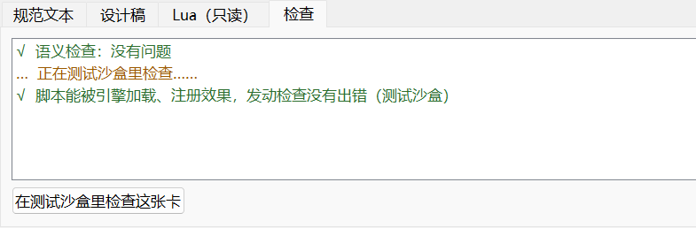

## 先认识一场决斗

从一个动作开始。你面前有一叠背面朝上的牌，叫作**卡组**。把最上面一张拿到手里，就叫**抽一张卡**。这份教程会带你做一张能在游戏里完成这个动作的卡。

### 牌在哪里

- **手卡**是你拿在手里、可以自己看的牌。效果写「自己」就是使用这个效果的一方，「对方」是另一位玩家。
- **场上**是两人放牌的地方。怪兽通常放在自己的**怪兽区**，魔法和陷阱通常放在**魔法与陷阱区域**。**表侧**指正面朝上，**里侧**指背面朝上。
- **墓地**放置正常使用完的通常魔法、被破坏并送去墓地的怪兽等。**除外**是卡片的另一种去向。一张卡能从哪里再使用，要看它的效果。
- **基本分**也写作 LP，是玩家的分数。普通决斗中双方通常各从 8000 开始。支付 500 基本分就是从自己的分数里扣掉 500。

### 什么时候能用牌

两人轮流进行自己的**回合**。在自己的**主要阶段**，你可以召唤怪兽、从手卡发动通常魔法，也可以把陷阱卡背面朝上盖好，等之后有合适的时机再发动。

**发动**是宣布使用卡或效果，**处理**是实际做它写的事。中间可以有人用别的效果回应。这些发动排成**连锁**，最后发动的先处理。

做第一张练习卡只用记住一句话。**在自己的主要阶段，从手卡发动这张魔法，处理时从自己的卡组抽一张。** 到「练习桌」可以照着搭法试。准备把这张卡留下时，点「返回 DIY 工作台」，在自己的卡包里搭建并保存草稿。

## 看懂效果页和积木槽

在窗口顶端选择 **DIY 工作台**，打开 **效果** 页。左侧独立的「卡包」「卡片」两列用来选正在做哪张卡。中间的积木编辑器又分三栏。

- **左栏**名叫「全部积木」，里面按「效果」「动作」「数值」等分类。点分类前的小箭头可以展开。
- **中栏**是这张卡已经装上的积木。实心色块代表一块积木，空心方框代表能放入积木的**槽**。向右缩进的一行属于它上面的那一块。
- **右栏**改当前积木的选项。点中栏的「抽卡」后，右边才会出现「谁」「几张」。只点左栏的名称不会改变卡片。

### 怎样把一块放到正确位置

先点中栏的**空心槽那一行**，左栏就只列出能放进去的积木。双击左栏想要的一块，它就会出现在槽下面。也可以从左栏把积木拖到中栏的槽上。点中栏的一块实心积木可再次看见完整目录。

「处理」槽收能做事的积木，例如抽卡、破坏。「哪些卡」槽收卡片，例如这张卡、之前选的对象。「多少」槽收数值，例如数字 500。「发动条件」收能回答“是或否”的判断。看槽名和左栏筛选结果就能搭，不用记颜色。

放错了可点 **撤销**。要移除一块，选中中栏的实心行，再点 **删除选中的积木**。删掉父块会连同它下面的积木一起移除。点行前的小箭头只是收起或展开。刚开始可开 **专注模式**，把更多空间留给积木。

## 第一张卡 · 让自己抽一张

做一张名叫「练习抽卡」的通常魔法。在本练习里只需要**两块积木**。

1. 在左侧「卡包」列点「新建」建一个练习包。新包已有一张名叫「青眼白龙」的模板卡，可以直接用它。若用已有的包，在相邻的 **卡片** 列点 **新建**，选中新卡。
2. 在 **卡面** 页把「卡名」改成「练习抽卡」。在「类型」选 **魔法卡**，魔法的类型选 **通常**。切回 **效果** 页。
3. 在左栏「效果」分类里双击 **会发动的效果**。中栏出现第一块积木。点它，在右栏把「效果类型」选为 **魔法·陷阱卡的发动**，时机保留「（没有，自由时点）」。
4. 展开这块积木，点它下面的空心 **处理** 行。在左栏「动作」下双击 **抽卡**。
5. 点中栏刚加入的抽卡积木，在右栏把「谁」设为 **自己**，「几张」设为 **1**。留空「几张（算出来的，可以空着）」即可。这个例子也用不到「发动条件」「代价」「对象」。

只看刚才用到的三行，中栏应有这样的缩进。最下面一行属于「处理」。

```text
效果 · 魔法·陷阱卡的发动
  └─ 处理
      └─ 自己抽 1 张卡
```

**核对一下。** 下方「规范文本」应显示「自己从卡组抽1张。」试把「几张」改为 2，读句也会变为抽 2 张。改回 1，再做下一节的对局检查。

在对局中，若自己手里原来有这张魔法和另外两张牌，发动并处理后，手里仍有三张。你用掉了一张魔法，也从卡组拿到了一张新牌。可以观察**卡组少了一张、手里多了一张新面孔**。

## 检查、保存和在游戏里试牌

### 看见正确的文字

打开效果页下方的 **规范文本**，把读到的句子和想做的事逐项对照。文字满意后点 **写回卡面**，卡面上就会印出这段效果。「设计稿」可用来对照原先的设计文字。「Lua（只读）」显示游戏要执行的指令。做这几张练习卡时，可以直接跳过这个标签。

### 让引擎读一次这张卡



点下方 **检查**，先看是否有标「×」的错误。若提示缺了某块，回到相应的槽补齐。再点 **在测试沙盒里检查这张卡**。「沙盒」指单独开的测试对局，它会尝试加载脚本、登记效果并检查发动时有没有出错。实际抽了几张、选中的怪兽去了哪里，可以在下一步亲自观察。

### 保存到哪里

- **下次接着做**。点左侧「卡片」下的 **保存草稿**。要把可继续编辑的积木带到另一台电脑，在「卡包」页点「导出这张卡…」或「导出这个卡包…」，选 **YGODIY 文件（.ydiy）**。
- **放进游戏试用**。在「卡包」页的「卡片一览」查看卡号。若仍是模板的官方卡号，可在**练习包**的「卡包设置」选择未被占用的卡号起点，再点「按顺序重新分配」。这个按钮会给当前包中的所有卡重新编号。
- 确认导出目标是要用的 MDPro3，再点 **导出并装进 MDPro3**。也可用「另存 .ypk / .cdb…」选择 **.ypk**，得到含卡片数据和效果脚本的对局卡包。单独的 **.cdb** 保存卡片数据，Lua 脚本随 .ypk 提供。
- 在 MDPro3 重新载入卡包（已开着游戏时可重启），在组卡界面按练习卡名或卡号找到它，放进自己的卡组。抽到「练习抽卡」后，等自己的主要阶段、魔法与陷阱区域有空位且卡组里有牌时发动，观察卡组和手卡的变化。

## 第二张卡 · 支付代价并选对象

新建另一张通常魔法「练习破坏」，再放一块 **会发动的效果**，类型仍选「魔法·陷阱卡的发动」。这次的目标是支付 500 基本分，选定对方场上一只怪兽，然后破坏它。

1. **代价**是宣布发动时先付的东西。点顶层效果的「代价」槽，双击 **支付基本分**。点它下面的「多少」槽，双击 **数字**，再选中这个数字，在右侧填 **500**。
2. **对象**是发动时就要指明的卡。点顶层效果的「对象」槽，双击 **取对象**。右侧「几张」填 **1**，「记作」保留 **T**。这个字母是给选中的卡起的临时名字。
3. 点「取对象」下的「从哪些卡里取」，双击 **全部**。选中这块，将「谁的」设为 **对方**，「在哪」只勾 **怪兽区**。「全部」提供候选范围，上一步的「几张」决定从中实际选几张。
4. 点顶层效果的「处理」槽，双击 **破坏**。点它下面的「哪些卡」槽，双击 **对象**，让右侧的「名字」同样为 **T**。处理时游戏就能找到先前选的那只怪兽。

**核对一下。** 「规范文本」应写出「支付500基本分，以对方场上1只怪兽为对象才能发动。那张卡破坏。」在对方有一只普通怪兽且双方都不回应时试一次，自己的基本分从 8000 变成 7500，那只怪兽从场上进墓地。再试对方怪兽区为空的局面，这时没有合法对象，卡应无法发动，基本分也不会扣。

如果对方在你发动后用另一张卡让那只怪兽先离开场上，原来选的对象就离开了。已经付出的 500 基本分依然付出，效果也不会改选另一只怪兽。这就是把「代价」「对象」「处理」分开放的用处。

## 第三张卡 · 给怪兽放指示物

**指示物**是放在卡上用来计数的标记。先做一只「练习魔术师」，让它在自己的主要阶段给自己放 1 个魔力指示物，每回合能用一次。

1. 新建卡片，在「卡面」选 **怪兽卡**，把怪兽的详细类型设为 **效果**，等级设为 **4**。这样试牌时，自己的怪兽区有空位，就能在自己的主要阶段使用本回合的通常召唤机会，把它从手卡放到场上。回到「效果」，双击 **会发动的效果**。
2. 选中顶层积木，把「效果类型」设为 **起动效果**，「在哪里发动」只勾 **怪兽区**，「次数」选 **这张卡1回合1次**。起动效果就是在自己的主要阶段主动选择使用的怪兽效果。
3. 在「处理」槽放 **放置指示物**。选中它，右栏选编号为 **0x1** 的魔力指示物，「几个」填 **1**。在「放在哪张卡上」槽放 **这张卡**。
4. 看「规范文本」，应当读到给**这张卡**放置 1 个魔力指示物。试牌时让它表侧留在自己的怪兽区。第一次发动并处理后计数应为 1，同一回合再试一次，这张怪兽的这个效果已用过。

### 改成只选自己系列的怪兽

「字段」是引擎识别一组卡用的系列编号。若想改为给自己某个系列的一只怪兽放标记，可以先复制练习怪兽。在「放在哪张卡上」槽中移除原来的「这张卡」，换成 **选几张**，设为自己、怪兽区、1 张。在它的「什么样的卡」槽放 **字段**。若积木读作「是『』卡」，点这块积木，核对右栏的字段编号和名称，或用 **查找字段…**、**新建字段…** 选定自己的系列。

还要让供选择的练习怪兽确实属于该系列。在那张卡的效果页顶部点「字段」设置它的归属。试验可先用练习怪兽自身，它的效果已经允许它放置这种指示物。自定义指示物时，在「放置指示物」右栏或「卡包 → 指示物」中可新建、查找，或修改本包定义的编号和名称。**字段编号**管哪一组卡符合筛选，**指示物编号**管放上去的是哪一种标记。

## 进阶 · 读懂一张实卡的脚本积木

已经会用中文动作搭效果后，可以看看实卡怎样告诉游戏“什么时候能发动、发动时要记什么、处理时做什么”。**Lua** 是游戏读取效果时使用的编程语言。这里可以展开脚本积木，直接观察它的每一部分。

1. 在练习包里新建一张通常魔法。打开效果页的 **脚本积木 → 从 MDPro3 实卡读取…**，输入「强欲之壶」或卡号 **55144522**。如有多份脚本，选想看的来源。
2. 展开中栏的 **整卡脚本积木**。**函数**是一组有名字的步骤。名字含有 `initial_effect` 的函数会向游戏登记这张卡有哪些效果。展开对应的发动检查和处理函数，就能追踪一次抽卡是怎么完成的。
3. **参数**是交给一个步骤的值，例如谁抽卡、抽几张。**变量**是暂时存一个值的名字。「如果」会先问一个能回答“是或否”的问题，再决定走哪一支。**循环**会把同一组步骤重复执行，比如依次处理每一张选中的卡。
4. 以「强欲之壶」为例，先看「检查玩家能否抽指定张数」，再看「记下效果处理要用的数值」和「登记即将进行的处理」。要试着改成抽 3 张，把这三处相应的 **2** 都改成 **3**。脚本积木的卡面说明文字也要一并调整。

「脚本积木」菜单还可以从本地 **.lua** 文件导入，或用「转换当前卡脚本」阅读自己已做好的效果。转换会替换当前卡的效果。想回到转换前，在同一菜单点 **还原上次转换**。普通的单步修改则用工具栏的「撤销」。

## 卡住时可以这样查

### 左边突然只剩很少几块

看中栏是否点着空心槽。此时左栏只显示能放进该槽的积木。想找「抽卡」，先点「处理」。想找「数字」，先点「支付基本分」下的「多少」。想看全目录，可点中栏任一实心积木。

### 双击后没有加进去，或右边没有设置

看中栏选中的那一行。要**加积木**，先点一个合适的空心槽。要**改选项**，点已经加进去的实心积木。只容一块的槽要换内容时，先选中里面的旧块并移除，再点空槽。点错可以马上「撤销」。

### 卡面写着抽两张，对局只抽一张

先在「效果」里选中「抽卡」，检查「谁」和「几张」。如果「几张（算出来的，可以空着）」里放了数值积木，实际张数由它决定。改好后看「规范文本」，点「写回卡面」，再重新导出并让游戏载入新卡包。若是从实卡转成的脚本积木，按上一节一起核对发动检查、登记的数量和处理。

### 对局里找得到卡，但点不出发动

先检查是「魔法·陷阱卡的发动」还是怪兽的「起动效果」，再看当前回合、阶段和卡所在区域。拿「练习破坏」来对照，自己需要付得出代价，对方场上也需要有可选怪兽。如果用的是单独导入的 .cdb，确认游戏还装有这张卡对应的效果脚本。

### 想继续查游戏规则

本教程的例子使用游戏王 OCG 的通常决斗规则。想看场地示意、回合流程或官方规则书，可打开[游戏王中文官网的玩法介绍](https://www.yugioh-card-cn.com/playing)。教程正文随程序提供，可离线阅读。
